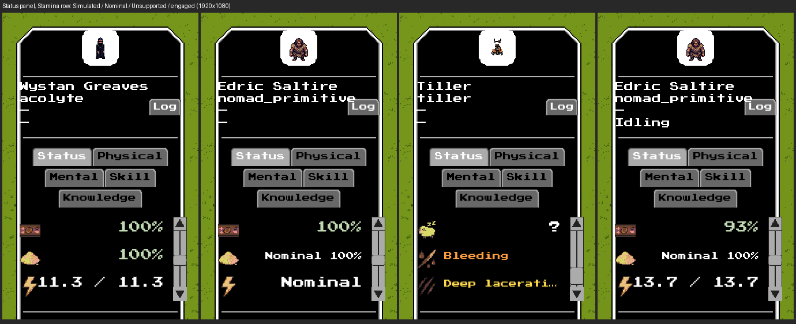
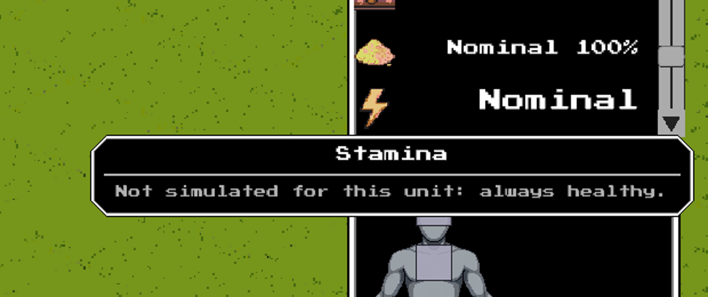

# #2834 — stamina modes in the unit UI: real offscreen evidence

S8a of epic #2827. Stamina is now a registry system, so the unit-info **Status
panel's Stamina row** follows the S6 contract (#2832): a **Simulated** stamina
keeps today's `cur / max` row, a supported **Nominal** one reads the word
`Nominal` in the neutral colour with the tooltip "Not simulated for this unit:
always healthy.", and an **Unsupported** (bodyless) unit's Stamina row is
hidden. The legacy debug text (`unit_info_panel.lua`) follows the same rule
(`Stamina: 11.30 / 11.30`, `Stamina: Nominal`, no line). A headless dump is not
the evidence here; these are real `--offscreen` frames (GPU on, window off) of
the shipped panel.

## Provenance

| | |
|---|---|
| Code under test | branch `issue-2834-stamina-modes` at **`bab1d722b`** (a review round that changes the panel re-takes the frames and updates this record) |
| Build | `cabal-3.16.1.0 build all`, production profile, GHC 9.12.2, macOS (Apple Silicon) |
| Resource root | the task worktree `~/worktrees/coghex/synarchy/issue-2834-stamina-modes` (`--resource-root`); no `config/*.local.yaml` |
| Port | **9019** (never 8008); one engine at a time, stopped by its own `engine.quit()` |
| Viewport | 1920x1080, UI scale 1.0 |

Setup and capture, exactly as run (the driver is
[`issue-2834-capture.py.txt`](issue-2834-capture.py.txt), adapted from #2832's;
copy it to a `.py`):

```sh
cd ~/worktrees/coghex/synarchy/issue-2834-stamina-modes
cabal-3.16.1.0 build all
python3 issue-2834-capture.py --out ev1080 --size 1920x1080 --port 9019
# boots:  $(cabal-3.16.1.0 list-bin exe:synarchy) --offscreen --port 9019 \
#         --size 1920x1080 --arena --resource-root "$PWD"
# waits for READY, the unit defs and the arena view, then:
#   engine.setPaused(true); world.setTimeScale(0); world.setSunAngle(0.5); engine.hideDebug()
#   unit.spawn x4 (acolyte, bear_brown, nomad_primitive, tiller) at tiles around pickTile(centre)
#   unit.injure(tiller, 'torso', 'slash', 0.5, 1.0)
# per unit: unit.hitTestAt locates the sprite; input.click SELECTS it through the shipped UI;
#   input.scroll over the stats rect scrolls the panel to the window that ends on the Stamina row;
#   input.moveMouse hovers the Nominal row (the engine's own dwell raises the tooltip);
#   debug.captureScreenshot per frame; engine.quit() at the end.
# the fourth frame: the engine is UNPAUSED, the nomad and the acolyte are put on one tile and a real
#   combat.attack(nomad, acolyte, 'quick') is resolved by the combat thread; the next physiology pass
#   applies the SD-20 engagement (marker 2, a pinned Simulated override, a seeded pool), and the engine
#   is paused again before the frame.
```

## The frames



Left to right (the row text is the real label read back from the panel,
recorded in [`issue-2834-captures-1920x1080.json`](issue-2834-captures-1920x1080.json)):

| Frame | Unit and stamina mode | Stamina row |
|---|---|---|
| 1 | acolyte, `rich`: Simulated | `11.3 / 11.3` (the colour of a healthy pool) |
| 2 | nomad, `exempt` with `stamina: nominal`, before any combat | `Nominal`, neutral colour |
| 3 | tiller, bodyless: Unsupported (one injury, so the window still shows rows) | **no Stamina row**: the window ends on the injury rows |
| 4 | the same nomad after its first admitted attack: Simulated, marker 2, pinned override | `13.7 / 13.7` |

The Nominal tooltip, raised by a real hover on frame 2's row:



The `cur / max` figures differ between frames only because the units are
spawned with rolled stats (the capture is a presentation check, not a
numerical one; the numbers are pinned in the headless group `physiology
stamina modes`). Frame 4 is the whole SD-20 story in one panel: the same unit
that read `Nominal` reads a seeded pool once a real strike has been admitted,
with no reselect and no rebuild beyond the mode change the panel's shape
signature already handles.
