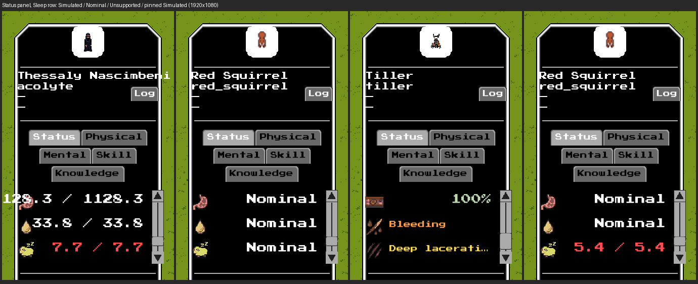
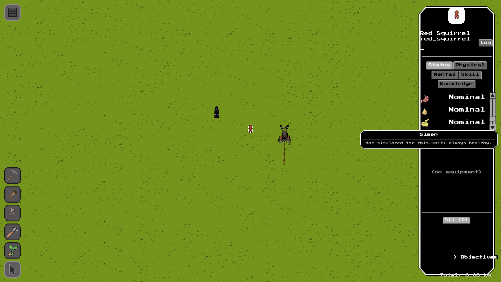

# #2835 — exhaustion and sleep modes in the unit UI: real offscreen evidence

S8b of epic #2827. Sleep pressure is now owned by the `sleep` system, so the
unit-info **Status panel's Sleep row** follows the S6 contract (#2832): a
**Simulated** sleep keeps today's `cur / max` row, a supported **Nominal** one
reads the word `Nominal` in the neutral colour with the tooltip "Not simulated
for this unit: always healthy.", and an **Unsupported** (bodyless) unit's Sleep
row is hidden. Exhaustion has no row (the issue asks for none). The squirrel's
sleep is Nominal by default (it has no `go_to_sleep` behavior), which is the one
intentional visible change. A headless dump is not the evidence here; these are
real `--offscreen` frames (GPU on, window off) of the shipped panel.

## Provenance

| | |
|---|---|
| Code under test | branch `issue-2835-exhaustion-sleep-modes` at **`98c7c59d9`** (a review round that changes the panel re-takes the frames and updates this record) |
| Build | `cabal-3.16.1.0 build all`, production profile, GHC 9.12.2, macOS (Apple Silicon) |
| Resource root | the task worktree `~/worktrees/coghex/synarchy/issue-2835-exhaustion-sleep-modes` (`--resource-root`); no `config/*.local.yaml` |
| Port | **9019** (never 8008); one engine at a time, stopped by its own `engine.quit()` |
| Viewport | 1920x1080, UI scale 1.0 |

Setup and capture, exactly as run (the driver is
[`issue-2835-capture.py.txt`](issue-2835-capture.py.txt), adapted from #2834's;
copy it to a `.py`):

```sh
cd ~/worktrees/coghex/synarchy/issue-2835-exhaustion-sleep-modes
cabal-3.16.1.0 build all
python3 issue-2835-capture.py --out ev1080 --size 1920x1080 --port 9019
# boots:  $(cabal-3.16.1.0 list-bin exe:synarchy) --offscreen --port 9019 \
#         --size 1920x1080 --arena --resource-root "$PWD"
# waits for READY, the unit defs and the arena view, then:
#   engine.setPaused(true); world.setTimeScale(0); world.setSunAngle(0.5); engine.hideDebug()
#   unit.spawn x3 (acolyte, red_squirrel, tiller) at tiles around pickTile(centre)
#   unit.injure(tiller, 'torso', 'slash', 0.5, 1.0)
# per unit: unit.hitTestAt locates the sprite; input.click SELECTS it through the shipped UI;
#   input.scroll over the stats rect scrolls the panel to the window that ends on the Sleep row;
#   input.moveMouse hovers the Nominal row (the engine's own dwell raises the tooltip);
#   debug.captureScreenshot per frame; engine.quit() at the end.
# the fourth frame: with the squirrel still selected, the facade's own verb
#   physiology.setMode(squirrel, 'sleep', 'simulated') pins its sleep Simulated (seeding the pool)
#   and the panel rebuilds without a reselect.
```

## The frames



Left to right (the row text is the real label read back from the panel,
recorded in [`issue-2835-captures-1920x1080.json`](issue-2835-captures-1920x1080.json)):

| Frame | Unit and sleep mode | Sleep row |
|---|---|---|
| 1 | acolyte, `rich`: Simulated | `7.7 / 7.7` (the format of a pool, unchanged) |
| 2 | red_squirrel, `simple`: Nominal (the shipped default) | `Nominal`, neutral colour |
| 3 | tiller, bodyless: Unsupported (one injury, so the window still shows rows) | **no Sleep row**: the window ends on the injury rows |
| 4 | the same squirrel, sleep pinned Simulated through the facade, nothing reselected | `5.4 / 5.4` |

The Nominal tooltip, raised by a real hover on frame 2's row:



The figures differ between frames only because the units are spawned with
rolled stats (the capture is a presentation check, not a numerical one; the
numbers are pinned in the headless group `physiology exhaustion and sleep
modes` and `UI.PhysiologyModes`). The squirrel's other two `Nominal` rows in
frames 2 and 4 are its hunger and hydration (the `simple` profile), unchanged
by this slice. Frame 4 beside frame 2 is the mode-switch rebuild in one panel:
the same selected unit reads `Nominal` and then a seeded pool.

The Simulated row's colour (red at a full pool in frame 1 and 4) is the
pre-existing sleep-pressure colour function, kept exactly: it colours by
`1 - cur / max` against thresholds that read a full pool as the danger band.
That is unchanged by this slice and not retouched here.
