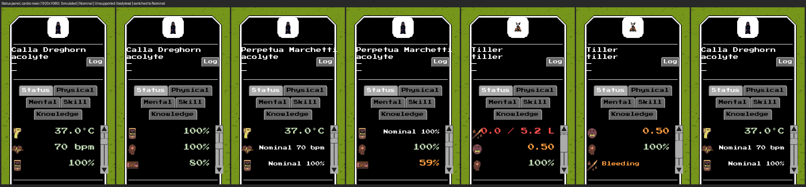
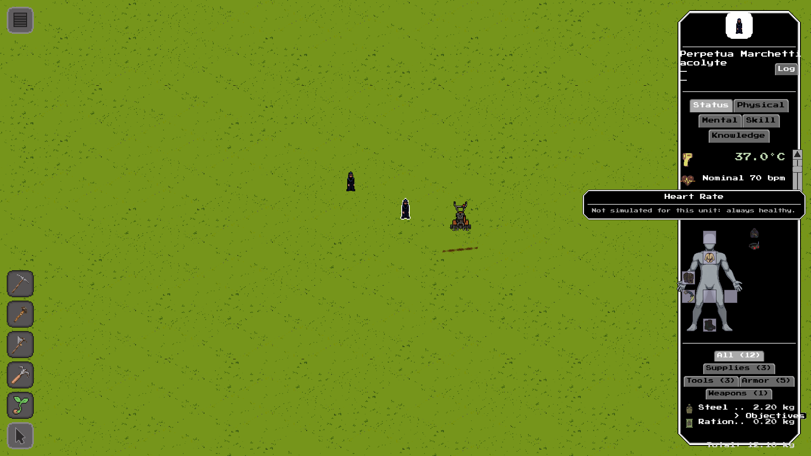
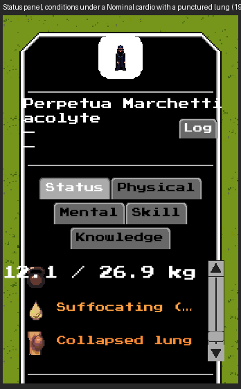

# #2836 — cardio modes in the unit UI: real offscreen evidence

S9 of epic #2827. Heart rate and blood oxygen are owned by the `cardio` system and
circulation is its on-demand derived key, so the unit-info **Status panel's three
cardio rows** follow the S6 contract (#2832) with one SD-21 exception. A
**Simulated** cardio keeps today's rows. A supported **Nominal** one reads
`Nominal 70 bpm` and `Nominal 100%` in the neutral colour with the tooltip "Not
simulated for this unit: always healthy.", but **Circulation keeps its LIVE value
and colour bands** (blood loss, sepsis, fitness and cold still act, so "always
healthy" would be false). An **Unsupported** (bodyless) unit shows none of the three.
The injury-driven **Suffocating** condition is unaffected by the mode. A headless dump
is not the evidence here; these are real `--offscreen` frames (GPU on, window off).

## Provenance

| | |
|---|---|
| Code under test | branch `issue-2836-cardio-modes` at **`e33b31c00`** (a review round that changes the panel re-takes the frames and updates this record) |
| Build | `cabal-3.16.1.0 build all`, production profile, GHC 9.12.2, macOS (Apple Silicon) |
| Resource root | the task worktree `~/worktrees/coghex/synarchy/issue-2836-cardio-modes` (`--resource-root`); no `config/*.local.yaml` |
| Port | **9019** (never 8008); one engine at a time, stopped by its own `engine.quit()` |
| Viewport | 1920x1080, UI scale 1.0 |

Setup and capture, exactly as run (the driver is
[`issue-2836-capture.py.txt`](issue-2836-capture.py.txt), adapted from #2835's; copy
it to a `.py`):

```sh
cd ~/worktrees/coghex/synarchy/issue-2836-cardio-modes
cabal-3.16.1.0 build all
python3 issue-2836-capture.py --out ev1080 --size 1920x1080 --port 9019
# boots:  $(cabal-3.16.1.0 list-bin exe:synarchy) --offscreen --port 9019 \
#         --size 1920x1080 --arena --resource-root "$PWD"
# then: engine.setPaused(true); world.setTimeScale(0); engine.hideDebug();
#   unit.spawn x3 (acolyte, acolyte, tiller)
#   the second acolyte: physiology.setMode(uid,'cardio','nominal') (the facade verb), a frail
#     constitution (raw debugging write of an UNOWNED stat), unit.injure(lungs, internal, 0.95)
#     and the unowned hypoxia meter set to 0.5, so the live circulation and the Suffocating
#     condition have something to show in a paused scene
# per unit: unit.hitTestAt locates the sprite; input.click SELECTS it through the shipped UI;
#   input.scroll scrolls the panel (it shows three rows at a time, so each unit is shot at
#   offsets 2 and 4); input.moveMouse hovers the Nominal row (the engine's own dwell raises
#   the tooltip); debug.captureScreenshot per frame; engine.quit() at the end.
# the last frame: with the first acolyte still selected, physiology.setMode(uid,'cardio',
#   'nominal') switches it and the panel rebuilds without a reselect.
```

## The frames



Left to right (the row text is the real label read back from the panel, recorded in
[`issue-2836-captures-1920x1080.json`](issue-2836-captures-1920x1080.json)). Each unit
is shown in two scroll windows because the panel has room for three rows: the first
holds body temp / heart rate / blood O2, the second blood O2 / consciousness /
circulation.

| Frames | Unit and cardio mode | Rows |
|---|---|---|
| 1-2 | acolyte, `rich`: Simulated (the shipped default) | `70 bpm`, `100%`, circulation `80%` (its rolled constitution and fat) |
| 3-4 | a second acolyte pinned Nominal, frail constitution | `Nominal 70 bpm`, `Nominal 100%` in the neutral colour, and circulation `59%` in the amber band, NOT the word Nominal |
| 5-6 | tiller, bodyless: Unsupported | **no Heart Rate, Blood O2 or Circulation row**: the windows show blood, pain, consciousness and the bleeding injury |
| 7 | the first acolyte after cardio is pinned Nominal through the facade, nothing reselected | `Nominal 70 bpm`, `Nominal 100%` |

The Nominal tooltip, raised by a real hover on frame 3's Heart Rate row:



The injury-driven Suffocating condition under the Nominal cardio (a punctured lung
and the unowned hypoxia meter at 50%), next to the collapsed-lung injury row:



The figures differ between units only because they are spawned with rolled stats (the
capture is a presentation check, not a numerical one; the numbers are pinned in the
headless groups `physiology cardio and circulation modes` and `UI.PhysiologyModes`).
Frame 4's circulation is lower than frame 2's because the Nominal cardio does not erase
the unit's fitness factor, which is the SD-21 behavior this slice implements.
