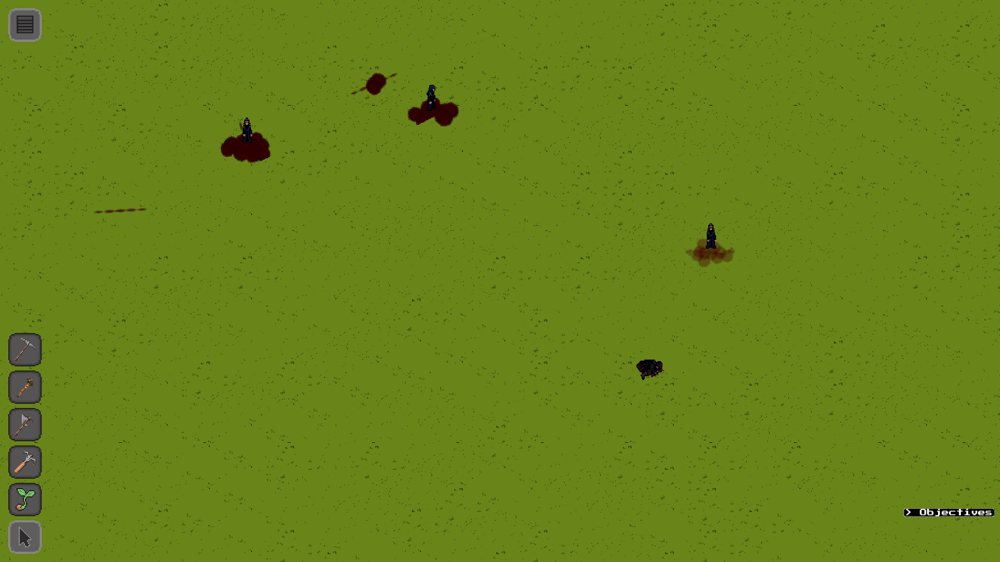
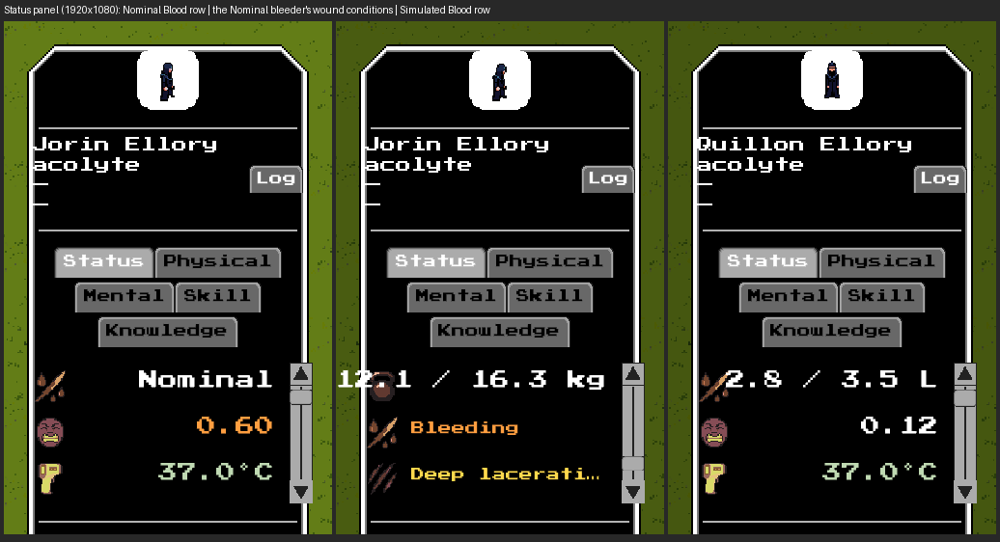
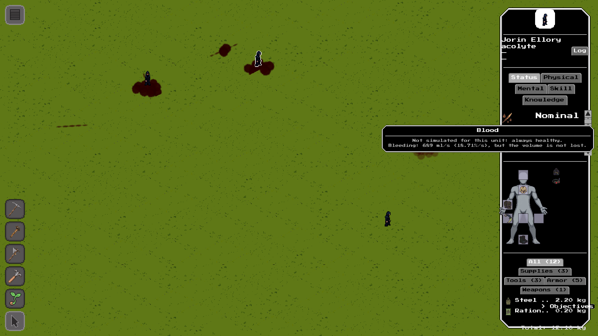

# #2837 — Nominal blood in the real game: offscreen evidence

S10 of epic #2827. Blood is owned by the `blood` system, whose volume lives in
the dedicated `uiBlood` field. A **Nominal** blood (an explicit per-unit override;
no shipped profile uses it) supplies a full readable volume (current = maximum,
fraction 1.0) and suppresses only the volume-specific effects: no drain, no
recovery, no blood-loss collapse and no exsanguination. Wounds, pain, infection,
necrosis and gangrene continue, the bleed rate stays live, and the visible
bleeding (trail and pool) continues, credited the wound-derived external flow
directly (the one intentional exception to #882's conserved-volume accounting).
A headless dump is not the evidence here; these are real `--offscreen` frames
(GPU on, window off) of the shipped game and panel.

## Provenance

| | |
|---|---|
| Code under test | branch `issue-2837-blood-modes` at **`9bec67e08`** (a review round that changes behavior re-takes the frames and updates this record) |
| Build | `cabal-3.16.1.0 build all`, production profile, GHC 9.12.2, macOS (Apple Silicon) |
| Resource root | the task worktree `~/worktrees/coghex/synarchy/issue-2837-blood-modes` (`--resource-root`); no `config/*.local.yaml` |
| Port | **9019** (never 8008); one engine at a time, stopped by its own `engine.quit()` |
| Viewport | 1920x1080, UI scale 1.0 |

Setup and capture, exactly as run (the driver is
[`issue-2837-capture.py.txt`](issue-2837-capture.py.txt), adapted from #2836's; copy
it to a `.py`):

```sh
cd ~/worktrees/coghex/synarchy/issue-2837-blood-modes
cabal-3.16.1.0 build all
python3 issue-2837-capture.py --out ev1080 --size 1920x1080 --port 9019
# boots:  $(cabal-3.16.1.0 list-bin exe:synarchy) --offscreen --port 9019 \
#         --size 1920x1080 --arena --resource-root "$PWD"
# then: unit_ai.update neutralised (commanded movement is the only movement);
#   unit.spawn x4 acolytes; the first three pinned Nominal through the facade verb
#   physiology.setMode(uid,'blood','nominal'); a severe slash (0.6) on the moving and
#   the pooling one, a slash dressed shut (seep 0) on the third, a moderate slash on
#   the fourth (Simulated, for contrast); unit.moveTo sends the moving and the sealed
#   unit east; after 14 s a world frame (debug.captureScreenshot); then, per unit,
#   unit.hitTestAt locates the sprite, input.click SELECTS it through the shipped UI,
#   input.scroll scrolls the panel, input.moveMouse hovers the Nominal row.
```

## The world



Two severe cuts that would exsanguinate a Simulated unit in seconds, both on a
**Nominal** blood and both still alive with a full volume: the moving unit left a
real trail of marks along its route and the stationary one grew a pool where it
stands. The unit sent along the same route with its wound dressed shut (seep 0)
laid no marks: the accumulator was cleared the instant external bleeding reached
zero. The bleeding-trail probe pins the same four cases numerically
(`nominal_moving_trail`, `nominal_stationary_pool`, `nominal_dressing`,
`nominal_internal_dry`) beside its unchanged Simulated conservation checks.

## The Status panel



Left to right (row text recorded in
[`issue-2837-captures-1920x1080.json`](issue-2837-captures-1920x1080.json)):

| Frame | Unit | Blood row |
|---|---|---|
| 1 | the moving Nominal bleeder | `Nominal` in the neutral colour |
| 2 | the same unit, scrolled to the end | the wound-driven **Bleeding** condition and the injury rows: no blood-loss collapse claim, no low-volume condition |
| 3 | the Simulated contrast unit | a real volume, `cur / max L` |

The Nominal tooltip, raised by a real hover on frame 1's Blood row, keeps the live
bleed rate beside the Nominal hint:



The units are spawned with rolled stats, so the figures (and the bleed rate in the
tooltip) differ run to run; the numbers are pinned in the headless groups
`physiology blood modes` and `UI.PhysiologyModes`.
