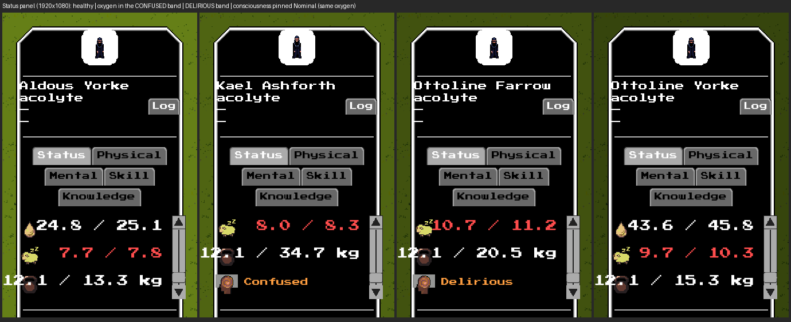

# #2838 — the derived consciousness in the real game: offscreen evidence

S11a of epic #2827. Consciousness, concentration and the unified state of mind
are no longer stored caches: they are computed on demand by the shared pure rules
(`Unit.Physiology.Mind`) and read by the Lua brain and the facade, by combat's
`mentalEffectiveness`, by `unit.getMentalEffectiveness` and by craft, all against
the same unit snapshot. This record shows that the shipped Status panel's
Consciousness-driven conditions (**Confused**, **Delirious**) are driven by that
derived value, and that a consciousness pinned Nominal (an explicit per-unit
override; no shipped profile uses it in S11a, S11b applies SD-23) reads a lucid
unit. A headless dump is not the evidence here; these are real `--offscreen`
frames (GPU on, window off) of the shipped game and panel.

## Provenance

| | |
|---|---|
| Code under test | branch `issue-2838-mind-modes` (the rendering path is the unchanged Status panel reading `physiology.get(uid, "consciousness")`; a later review round that changes behavior re-takes the frames and updates this record) |
| Build | `cabal-3.16.1.0 build all`, production profile, GHC 9.12.2, macOS (Apple Silicon) |
| Resource root | the task worktree `~/worktrees/coghex/synarchy/issue-2838-mind-modes` (`--resource-root`); no `config/*.local.yaml` |
| Port | **9019** (never 8008); one engine at a time, stopped by its own `engine.quit()` |
| Viewport | 1920x1080, UI scale 1.0 |

Setup and capture, exactly as run (the driver is
[`issue-2838-capture.py.txt`](issue-2838-capture.py.txt), adapted from #2837's; copy
it to a `.py`):

```sh
cd ~/worktrees/coghex/synarchy/issue-2838-mind-modes
cabal-3.16.1.0 build all
python3 issue-2838-capture.py --out ev1080 --size 1920x1080 --port 9019
# boots:  $(cabal-3.16.1.0 list-bin exe:synarchy) --offscreen --port 9019 \
#         --size 1920x1080 --arena --resource-root "$PWD"
# then: unit_ai.update and cardio.tick neutralised (nothing wanders, the held input
#   stays held); unit.spawn x4 acolytes (the all-Simulated S11a default); the stored
#   INPUT blood_oxygen set with unit.setStat on the second (0.65), third and fourth
#   (0.59); the fourth's consciousness pinned Nominal through the facade verb
#   physiology.setMode(uid,'consciousness','nominal'); per unit, unit.hitTestAt
#   locates the sprite, input.click SELECTS it through the shipped UI, input.scroll
#   scrolls the Status tab to its bottom, debug.captureScreenshot reads the frame.
```

## The Status panel



| Frame | Unit | Derived reads (`unit.readPhysio`) | The panel shows |
|---|---|---|---|
| [healthy](issue-2838-1920x1080-healthy-status.png) | acolyte | consciousness 1.000, concentration 1.000, state of mind 0.999 | no mental condition |
| [confused](issue-2838-1920x1080-confused-status.png) | acolyte, oxygen 0.65 | consciousness **0.500**, concentration 0.500, state of mind 0.500 | **Confused** |
| [delirious](issue-2838-1920x1080-delirious-status.png) | acolyte, oxygen 0.59 | consciousness **0.300**, concentration 0.300, state of mind 0.300 | **Delirious** |
| [nominal](issue-2838-1920x1080-nominal-status.png) | acolyte, oxygen 0.59, consciousness pinned Nominal | consciousness **1.000** (mode `nominal`), concentration 1.000 | no mental condition, with the same oxygen as the delirious unit |

Every value above comes from the same rule: `consciousness = min(temperature,
(oxygen − 0.5) / 0.3, salt)`, so oxygen 0.65 reads 0.5 (the confused band,
below 0.70) and 0.59 reads 0.3 (the delirious band, below 0.40). None of the four
stores a consciousness, concentration or state of mind (`unit.getStatBase` reads
`nil` for each): the panel reads the on-demand value, and the Nominal unit's
substitute is what makes it lucid under the same stored oxygen. The captured
numbers are in [`issue-2838-captures-1920x1080.json`](issue-2838-captures-1920x1080.json).

## What this does and does not show

* It shows the displayed consciousness conditions follow the derived value and the
  mode substitute. It does not show combat, craft or the mental machine: those are
  covered by the `physiology brain and mental atomicity` and `Mental effectiveness`
  hspec groups and the mental, craft and persistence probes (see the PR body).
* The unit panels' red sleep rows are unrelated (the units were never rested).
