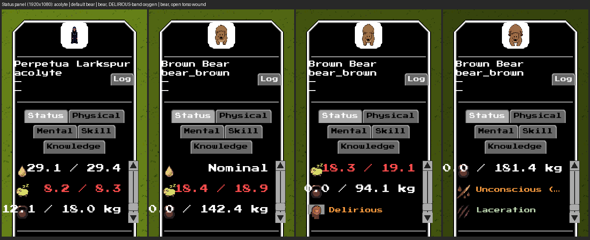

# #2840 — a default Nominal mind in the real game: offscreen evidence

S11b of epic #2827 (SD-23). Only the acolyte keeps a Simulated mind; the bear,
squirrel, technomule and nomad resolve mind Nominal from the shipped profiles
(`reduced`, `simple`, `exempt`), with consciousness Simulated everywhere. The
Status panel has no break, stressed, euphoria or thought condition of its own:
its mental rows read the live consciousness (**Confused**, **Delirious**) and the
injury, bleeding and collapse rows read wounds and blood. This record shows,
from real `--offscreen` frames (GPU on, window off) of the shipped game, that
the panel for an unmodified bear (mind Nominal by default, no override anywhere)
shows no stale episode condition while its LIVE consciousness and injury status
remain. A headless dump is not the evidence here.

## Provenance

| | |
|---|---|
| Code under test | branch `issue-2840-mind-species-profiles` at `160e01788` (the rendering path is the unchanged Status panel; the profile content is the only runtime change) |
| Build | `cabal-3.16.1.0 build all`, production profile, GHC 9.12.2, macOS (Apple Silicon) |
| Resource root | the task worktree (`--resource-root`); no `config/*.local.yaml` |
| Port | **9019** (never 8008); one engine at a time, stopped by its own `engine.quit()` |
| Viewport | 1920x1080, UI scale 1.0 |

Driver: [`issue-2840-capture.py.txt`](issue-2840-capture.py.txt) (adapted from #2838's;
copy it to a `.py`; it writes `1920x1080_*` frames, renamed `issue-2840-1920x1080-*`
here):

```sh
cd ~/worktrees/coghex/synarchy/issue-2840-mind-species-profiles
cabal-3.16.1.0 build all
python3 issue-2840-capture.py --out ev1080 --size 1920x1080 --port 9019
# boots:  $(cabal-3.16.1.0 list-bin exe:synarchy) --offscreen --port 9019 \
#         --size 1920x1080 --arena --resource-root "$PWD"
# then: unit_ai.update and cardio.tick neutralised; unit.spawn of an acolyte and three
#   bears (shipped definitions, no override); the stored INPUT blood_oxygen 0.59 on the
#   second bear (unit.setStat, a Simulated cardio key); unit.injure(torso, slash) on
#   the third; on the first bear a stress batch via unit.commitPhysio (REFUSED:
#   nil|forbidden_key:mental_since) and mental.forceBreak (a no-op); per unit,
#   unit.hitTestAt locates the sprite, input.click SELECTS it through the shipped UI,
#   input.scroll scrolls the Status tab, debug.captureScreenshot reads the frame.
```

## The Status panel



| Frame | Unit | Reads (`unit.readPhysio` / `getPhysioMode`) | The panel shows |
|---|---|---|---|
| [acolyte](issue-2840-1920x1080-acolyte-status.png) | acolyte | mind **simulated**, mood 0.973 stored, consciousness 1.000 | no mental condition (its mind is live) |
| [bear](issue-2840-1920x1080-bear-status.png) | bear_brown, default | mind **nominal**, no pin, mood 1.0 with **no stored mood**, mental_state 0 (STABLE), consciousness 1.000, state of mind 1.000, after a refused stress batch and a no-op `forceBreak` | no mental condition: no break, stressed, euphoric or thought state can appear |
| [bear_delirious](issue-2840-1920x1080-bear_delirious-status.png) | bear_brown, oxygen 0.59 | mind nominal, consciousness **0.300** (simulated, live), concentration 0.300, state of mind 0.300 (= consciousness) | **Delirious**: the physiological condition survives a Nominal mind |
| [bear_injured](issue-2840-1920x1080-bear_injured-status.png) | bear_brown, open torso slash | mind nominal, consciousness 1.000, concentration 0.980 (injury pain still erodes it) | **Unconscious (blood loss)** and **Laceration**: bleeding, collapse and the injury list are unchanged |

The captured numbers are in
[`issue-2840-captures-1920x1080.json`](issue-2840-captures-1920x1080.json). The
bears store none of `mood`, `emotional_pain`, `caffeine`, `mental_state`,
`mental_since`, `mental_until`, `mental_next_roll_at`, `mental_cooldown_until`,
`mental_high_since`, `mental_break_behavior`, `thought_next_at` (`stored_mood`
is `nil`) and none of the derived values; the acolyte, whose mind is Simulated,
does.
